<p align="center">
  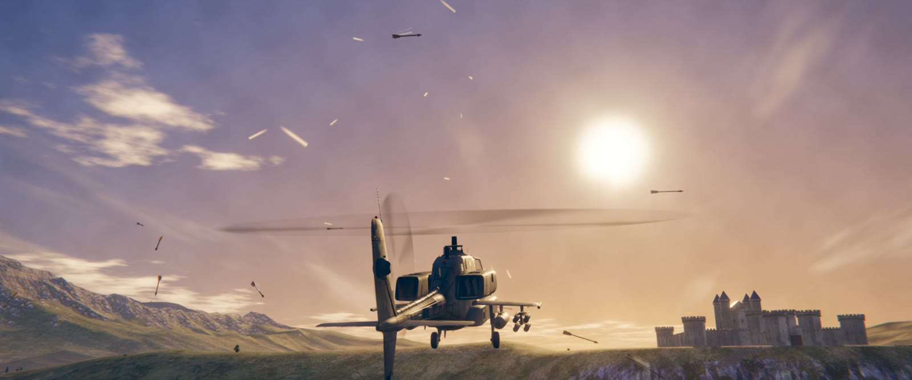
</p>

<h1 align="center">SIEGE WING</h1>

<p align="center"><b>One gunship. Two thousand soldiers. Ten minutes of daylight.</b></p>

<p align="center">
  <a href="https://wjw12.github.io/siege-wing/"><b>▶ Play in your browser</b></a>
  &nbsp;·&nbsp;
  <a href="https://github.com/wjw12/siege-wing/releases/latest"><b>⬇ Download</b></a>
  &nbsp;·&nbsp;
  <a href="#how-to-play">How to play</a>
</p>

---

Can a helicopter win a medieval war?

A warlord has dug in on a ridge with a castle, a field army of six formations, archer companies, ballistae on the towers, bombards on the walls and trebuchets in the yard. You have one attack helicopter and the time it takes the sun to go down.

Weave through arrow volleys, ballista bolts and flaming trebuchet boulders. Break their formations, bring down the gate towers and hunt the warlord in his own courtyard. When you run dry or start trailing smoke, limp back to the pad on the eastern hill and rearm while they shoot at you.

It flies like a Battlefield chopper. The mouse pitches and rolls, W and S work the collective, and you dip the nose to move.

<p align="center">
  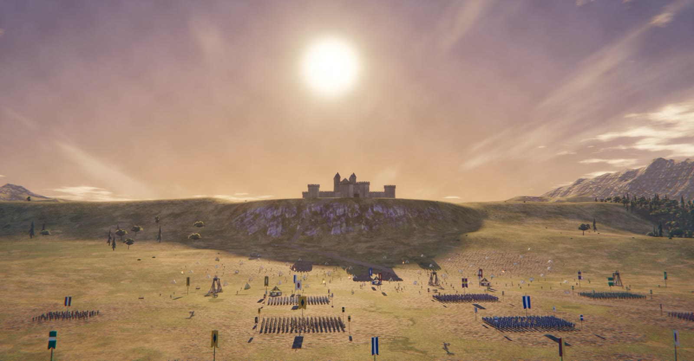
</p>

## Features

- **A full siege in one valley.** Around 2,000 soldiers hold formation, raise shields, scatter under fire and rout when their banner falls. Archers loose massed volleys, and ballistae and bombards track you from the walls.
- **Arcade handling with a sim mode underneath.** Assault mode holds your altitude and forgives mistakes. Punishing mode gives you a raw collective, torque and vortex ring state with no assists, and pays full score for it.
- **Three weapons, one trigger.** A 30 mm chin cannon you aim with the mouse, rocket pods that land where the nose points, and guided missiles that drop a tower with one hit after a two-second lock.
- **Damage you can feel.** Arrows chip the hull. Ballista bolts break subsystems: canopy, engine, hydraulics, main rotor, tail rotor and weapons. A damaged helicopter flies like one.
- **A crew that talks.** Your gunner calls threats, command tracks the battle, the warning system nags you about the ceiling, and the enemy shouts orders you can hear from the air. All voice, music and sound effects were generated for this game.
- **Golden hour that runs out.** The light drops as the clock runs. Ten minutes in, it's dark and the run is over.
- **Runs in a browser tab.** No install and no plugin. WebGL2 and a mouse are all you need.

## Fly it

Switch between the chase camera and a full cockpit with live displays at any time. Hold Alt to look around the canopy.

<p align="center">
  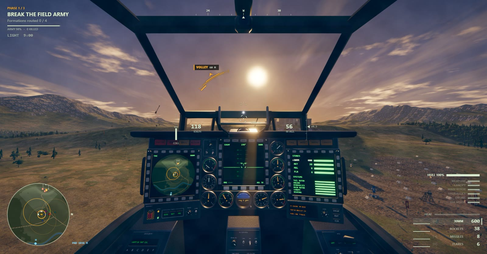
</p>

## Break the army

Dive on a formation and ripple the rockets. Kill the knights around a banner and the whole block breaks and runs. A fast, low pass breaks the shield wall.

<p align="center">
  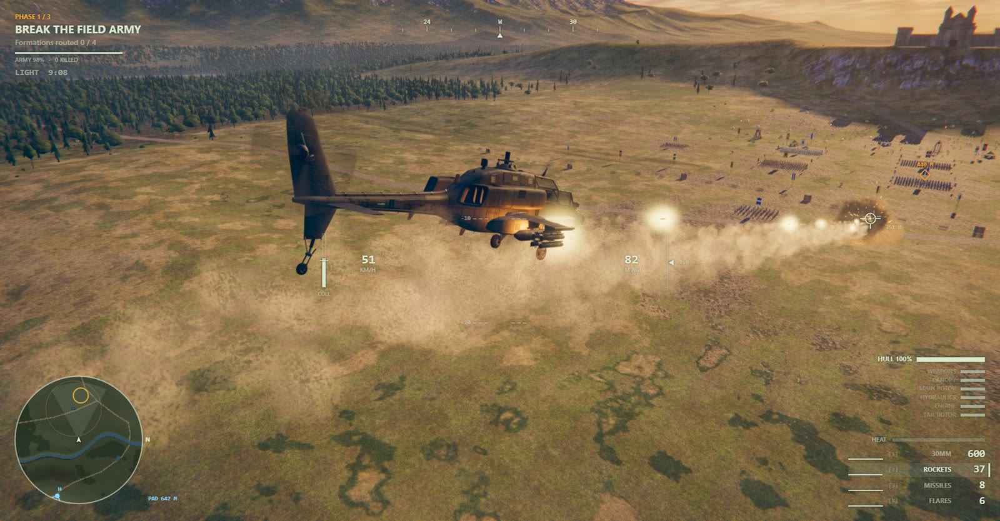
</p>

## Bring down the walls

Four gate towers, each with a ballista on top. A missile cracks a tower, then rockets or the cannon finish it. Every steady second you spend lining up is a second they spend aiming at you.

<p align="center">
  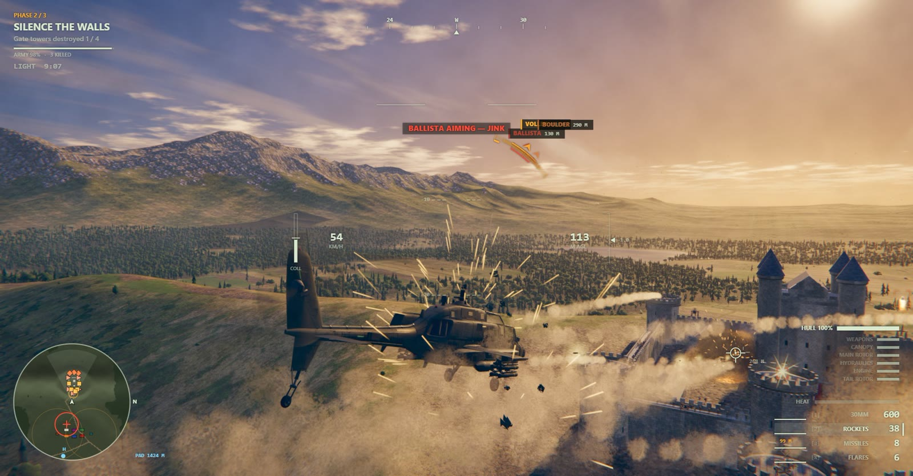
</p>

## Survive

Everything on the ground is trying to hit a helicopter that holds still. The HUD calls each threat as it launches: volleys, ballista tells, boulders and flak. Jink on the warning and drop flares to break their aim.

<p align="center">
  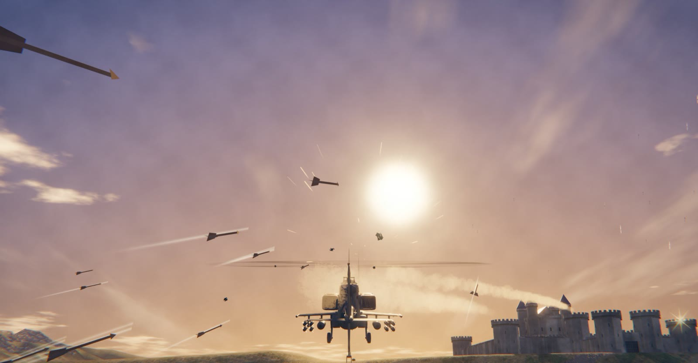
  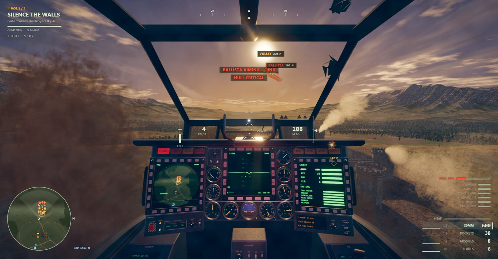
</p>

## Kill the warlord

He waits in the courtyard with his guard, walls on every side. Get him before the sun goes down.

<p align="center">
  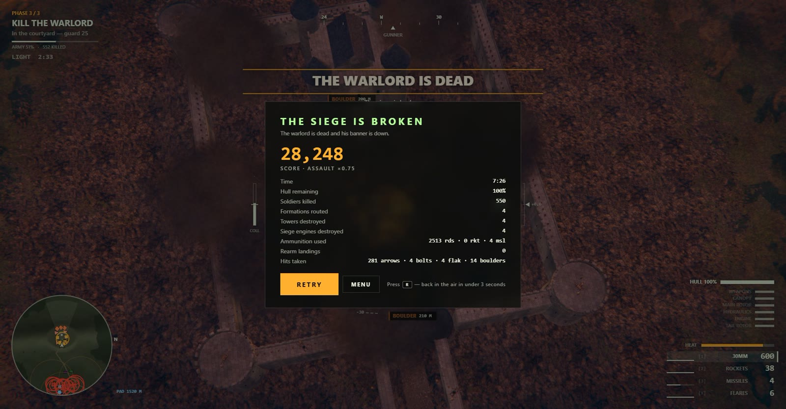
</p>

## How to play

An illustrated field guide opens before your first take-off. You can also open it from the title screen and the pause menu.

<p align="center">
  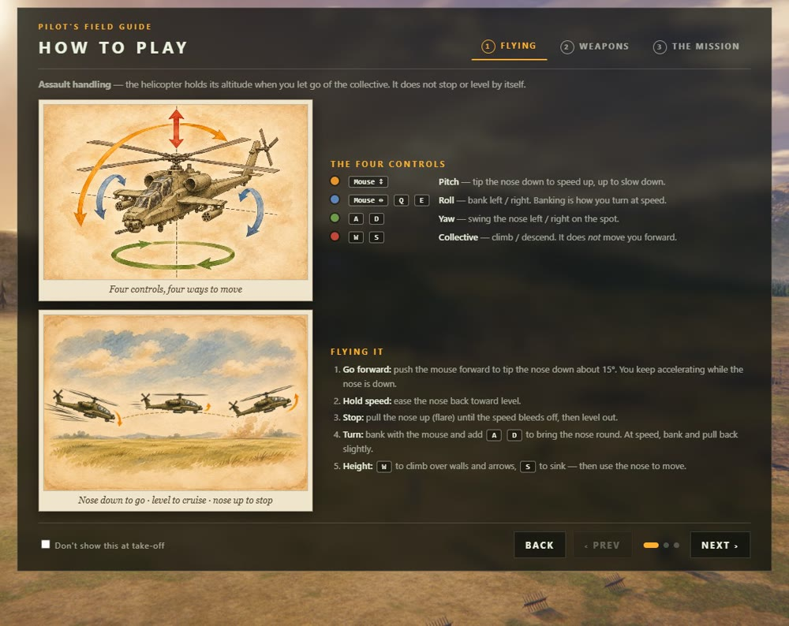
  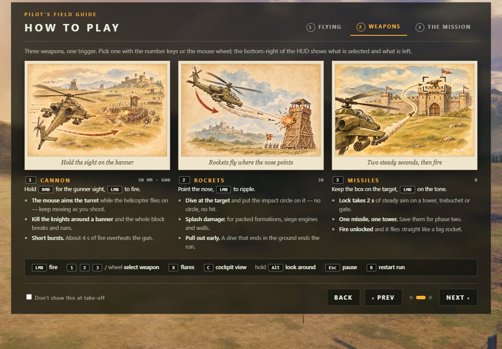
  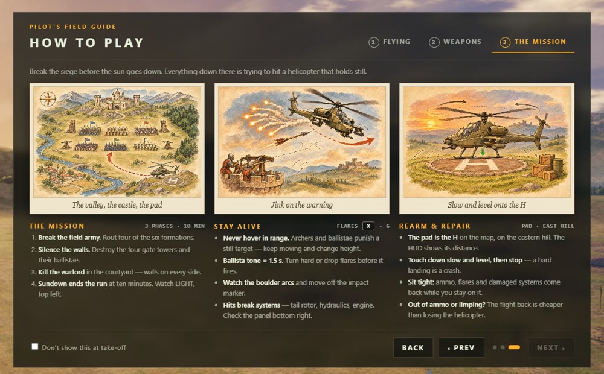
</p>

### The mission

1. **Break the field army.** Rout four of the six formations.
2. **Silence the walls.** Destroy the four gate towers and their ballistae.
3. **Kill the warlord** in the courtyard.

Land on the pad on the eastern hill to rearm and repair. Full dusk falls at ten minutes.

### Controls

| Input | Action |
|---|---|
| Mouse | Pitch and roll |
| W / S | Climb / descend |
| A / D | Yaw |
| Q / E | Roll (keys) |
| Left mouse | Fire |
| Right mouse (hold) | Gunner mode: the mouse aims the cannon through a zoomed sight |
| 1 / 2 / 3 or wheel | Cannon / rockets / missiles |
| X | Flares |
| C | Cockpit / chase view |
| Alt (hold) | Free look |
| Esc / P | Pause |
| R | Restart |

Keys can be rebound in Settings. The "Battlefield" preset moves yaw to the mouse and roll to A / D.

### Handling modes

| Mode | Handling | Score |
|---|---|---|
| **Assault** (default) | Mouse pitch and roll; W / S set a climb rate and the helicopter holds altitude when you let go | ×0.75 |
| **Punishing** | Raw collective, torque and vortex ring state, no assists | ×1.0 |
| **Stabilized** | Attitude hold and auto-hover | ×0.5 |

## System requirements

| | |
|---|---|
| **Browser** | Desktop Chrome or Edge (WebGL2 and Ogg Vorbis audio) |
| **Input** | Mouse and keyboard |
| **Graphics** | A dedicated GPU is recommended. Quality presets (High / Medium / Low) are in Settings. |
| **Download** | About 100 MB on first load |

<p align="center">
  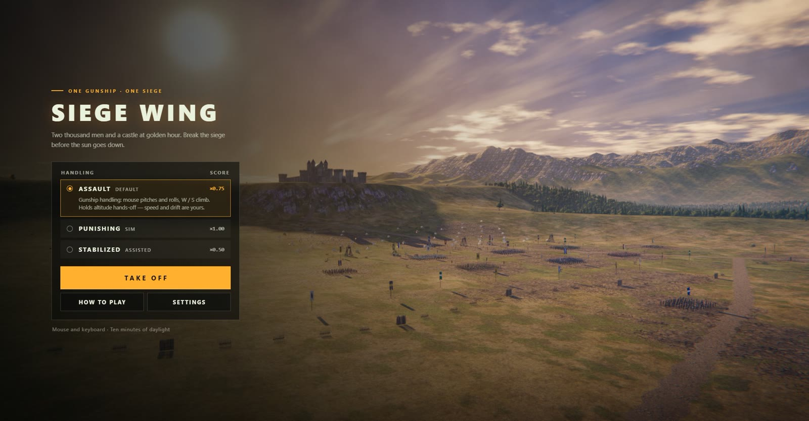
</p>

---

## Made with Claude

Claude (in Claude Code) designed the game and wrote all of its code, along with the pipelines that made the assets:

- **Blender.** Every model, from the helicopter and soldiers to the castle, village and props, is built procedurally by Python scripts in `tools/blender/`. Claude ran them in Blender over a small file bridge (`BLENDER_BRIDGE.md`).
- **ElevenLabs API.** Every sound effect, voice line and music track was generated by `tools/audio_gen/`.
- **Poly Haven.** The ground uses photoscanned CC0 materials.

The design document is [`Game_Design.md`](Game_Design.md).

## Running it locally

```
git clone https://github.com/wjw12/siege-wing.git
cd siege-wing
python3 tools/serve.py 8765
```

Open http://localhost:8765/ in Chrome or Edge and click to capture the mouse. You can also double-click `play.bat` on Windows or run `./play.sh` on Linux / macOS (both need Python 3). The [release zip](https://github.com/wjw12/siege-wing/releases/latest) is the same game with the same launchers.

### Under the hood

- Three.js 0.170 on WebGL2, plain ES modules with no build step. Game code is in `src/`.
- HDR rendering with 4× MSAA, adaptive supersampling and FXAA. Two texel-snapped shadow cascades. Ground textures are blended by height from texture arrays.
- Sampled audio (`assets/audio/manifest.json`) layered over a procedural engine and rotor synth (`src/audio.js`). Voice and music are sequenced by `src/director.js`.
- `tools/build_artifact.py` stages the game for publishing as a single-link Claude artifact.
- The lossless audio sources and Blender preview renders aren't in git. They're in `SiegeWing-1.0-source-assets.zip` on the [v1.0 release](https://github.com/wjw12/siege-wing/releases/tag/v1.0).
